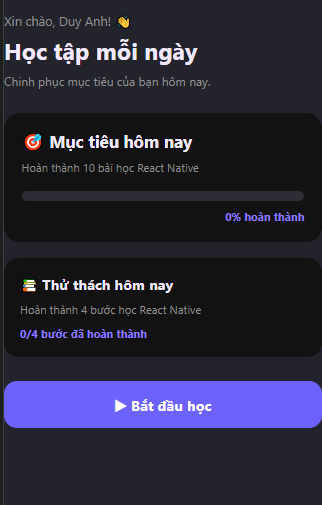
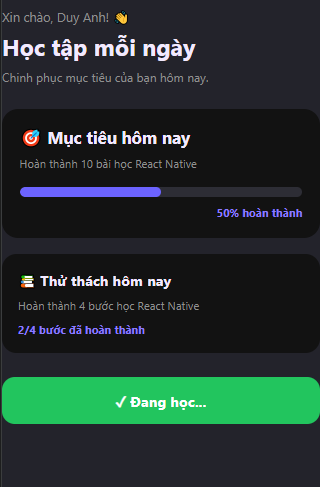
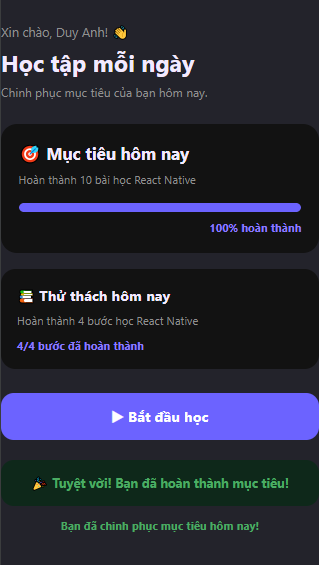

# AnimateApp

## 1. Link ứng dụng Expo

**Tên bài nộp:** AnimateApp

**Link ứng dụng:** https://snack.expo.dev/@voduyanh/animateapp

## 2. Các dòng code và hình ảnh sự thay đổi giao diện của các thành phần trong component và các component

### 2.1. Các component

- [App.js](App.js)
- [ProgressCard.js](components/ProgressCard.js)
- [ActionButton.js](components/ActionButton.js)
- [AnimatedMessage.js](components/AnimatedMessage.js)

### 2.2. Hình ảnh giao diện và sự thay đổi

**Giao diện ban đầu – 0%**

**Giao diện đang thực hiện – 50%**

**Giao diện hoàn thành – 100%**

